<!-- BANNER -->

<!-- TYPING ANIMATION -->

 

---

## `Sobre mim`

### Languages & Development

### Systems & Security

> Tools and technologies shown here represent my learning interests and workflow; this list will evolve as I gain experience.

## `Projetos

| Project | Description |
|---|---|
| [Aprendizados-FACULD](https://github.com/Zeng-exe/Aprendizados-FACULD) | Academic exercises and programming practice |
| [Python Projects](https://github.com/Zeng-exe?tab=repositories&q=python) | Python learning and development projects |
| [Cybersecurity Labs](https://github.com/Zeng-exe?tab=repositories) | Security studies, experiments and future labs |

*Replace or add project links above as you publish repositories.*

## `Stats`

  
  

  

  

---

    

